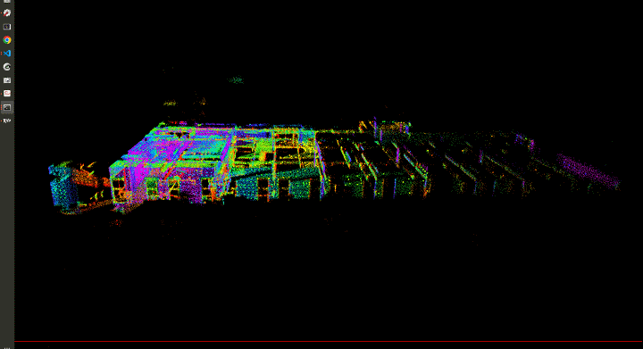
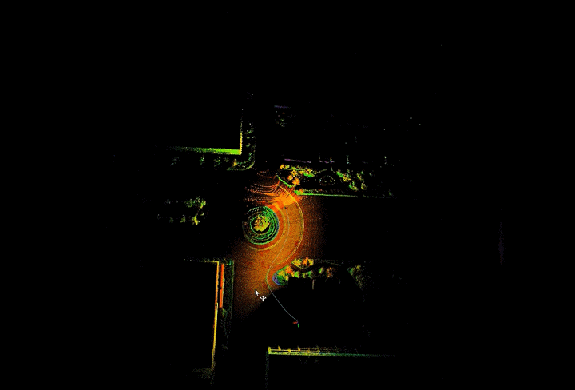
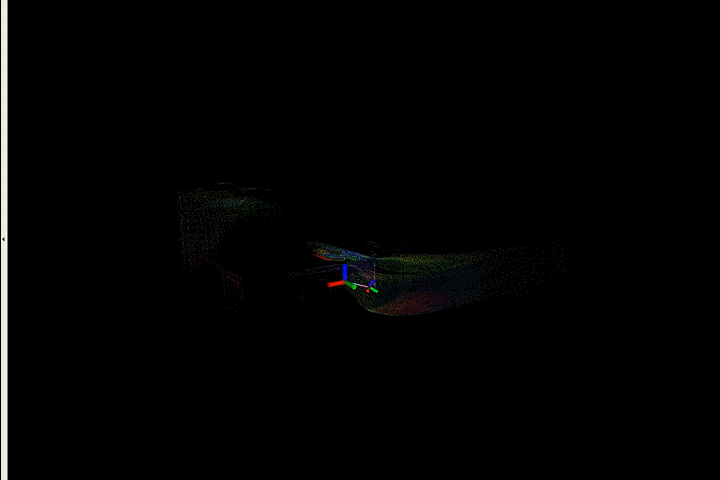

# LIO-SAM-MID360

本代码为 LIO-SAM 的当前主包，支持 Livox MID360，也包含 M20 前置 RoboSense
Airy `PointCloud2`/IMU 输入和四轮运动学入口。支持使用六轴和九轴 IMU。

## Dependency

- 与LIO-SAM有相同依赖 ( [LIO-SAM](https://github.com/TixiaoShan/LIO-SAM/) ）
- 请安装LIVOX ROS包用于发布点云数据 ( [览沃 ROS 驱动程序](https://github.com/Livox-SDK/livox_ros_driver/) )

如果使用Livox-ros-driver2 驱动可以切换分支为 [Livox-ros-driver2](https://github.com/nkymzsy/LIO-SAM-MID360/tree/Livox-ros-driver2) 。

## Prepare lidar data

Livox MID360雷达数据请使用览沃自定义点云数据`CustomMsg`，即LIVOX ROS驱动请运行`livox_lidar_msg.launch`。

## Run

使用自带的6轴IMU请运行

```
roslaunch lio_sam run6axis.launch
```

使用9轴IMU请运行

```
roslaunch lio_sam run9axis.launch
```

M20/Airy 请运行：

```
roslaunch lio_sam run_m20.launch use_sim_time:=true enable_rbf_constraint:=true
```

另一个终端使用 `rosbag play --clock /absolute/path/to/m20_upstairs.bag`。
M20 配置已包含编码器方向、零偏和角度归一化；输出关节使用 URDF 坐标。
需要基础 LIO 对照时将 `enable_rbf_constraint` 设为 `false`。
关节转换依据、IMU 符号和完整测试 bag 回放方式见仓库根目录
`README.md` 与 `docs/HANDOFF_UBUNTU.md`。

## Test

- 室内环境旋转测试



- 室外环境 倾斜手持



- 室内环境



## Note

- 注意对齐Lidar与IMU的时间戳。
- 使用非自带IMU注意修改Lidai与IMU的外参。(param.yaml文件)
- 六轴 IMU 的 `imuType: 0` 输入按 `g` 转成 `m/s^2`；不同设备的测量符号通过
  `imuAccelerationSign` 配置，不能通过修改源码或盲用 M20 参数处理。
- 如果观察到IMU里程计抖动的话，请调节IMU参数

## TODO

- [ ] 提取特征优化

## Acknowledgement

- [LIO-SAM](https://github.com/TixiaoShan/LIO-SAM/)
- [LIO-SAM-DetailedNote](https://github.com/smilefacehh/LIO-SAM-DetailedNote)
- [LIO_SAM_6AXIS](https://github.com/JokerJohn/LIO_SAM_6AXIS)
